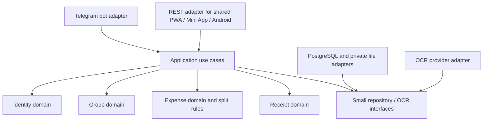

# Expense Mother — Backend Technical Design

**Revised design · 10 September 2026 · Go backend and Telegram chat UI implemented; see [implementation notes](implementation.md) for validation and delivery scope.**

Source: [webExpenseMotherV1.yml](../webExpenseMotherV1.yml), OpenAPI 3.0.3, contract revision 1.1.0. The YAML has been updated to match this design; original `/v1` paths are retained.

## 1. Direction and agreed scope

Build a bill-sharing application with a **Telegram group bot as the first client**, backed by a practical domain-driven Go/PostgreSQL application. Members create orders/expenses, participate in drafts, select receipt items, view personal and group totals, and mark full or partial shares as paid.

One responsive **mobile web app / PWA** will provide the standalone website/mobile experience and run as a **Telegram Mini App** using the same UI code. This captures the intended “TWP” client. Native Android can follow; shared UI does not require shared authentication mechanics or offline financial writes.

Confirmed decisions:

- Domain-driven design within one application, with functionality first.
- JSON money remains numeric. Amounts are in whole **Rials**; `currency` is a free-form string defaulting to `Rials`, with no enum, currency registry, or exchange conversion.
- Persian and English receipt OCR, editable extraction, and manual fallback.
- Orders include incomplete drafts; members can participate before the purchase details are finalized. Drafts do not contribute to debt.
- Go/PostgreSQL, named guest participants, shared INCOME behavior, and self-reported payment status are accepted.
- Telegram-backed passwordless sign-in provides one account across bot, Mini App, and browser.

General idempotency, load balancing, queues, event sourcing, and distributed processing remain deferred. Authentication proof checks, exact arithmetic, ordinary database transactions, and access rules are essential feature behavior rather than a separate hardening project.

This revision updates the technical document and YAML only. Backend code, bot registration, external OCR configuration, and deployment are not performed in this stage.

## 2. First-release Telegram workflows

### Group setup and membership

1. A Telegram group administrator adds the bot and runs `/setup`.
2. The application creates a group linked to that chat, or an existing application administrator explicitly links an existing group. Default: one application group per chat.
3. The group uses `currency: Rials` by default and the setup user becomes its application administrator; no currency-selection workflow is needed at launch.
4. Members use `/join` or an expense button to register their Telegram identity and join the application group. Do not attempt to import all chat members automatically.

Telegram numeric user IDs identify external accounts; internal users retain UUIDs for other clients. Store Telegram user/chat IDs in 64-bit-capable fields. Verify chat membership when accepting a participant, so a forwarded message cannot grant an outsider access. For reliable membership lookup, configure the required bot administrator permissions or require application-administrator approval. Telegram documents the permissions and limitations of `getChatMember` in its [Bot API](https://core.telegram.org/bots/api#getchatmember).

Telegram roles do not silently rewrite application roles after setup. Preserve departing members' historical obligations; they can view and settle their own past shares without seeing newly created group expenses.

### Add an expense and participate

1. A member sends `/expense Dinner 1200000` or answers a short bot prompt. Start with commands and guided input; unrestricted natural-language parsing is not required for launch.
2. The bot posts a **draft expense card** showing payer, amount/currency, description, participants, and buttons: **Join**, **Leave**, **My share**, **Finalize**.
3. Members join or leave while the expense is a draft; the bot recalculates the preview. Creators may also select already-registered participants. Initial split options are equal, weighted, and receipt-item allocation.
4. The creator or application administrator checks the totals and finalizes. Finalization fixes participation and includes the expense in balances.
5. Later participation changes require explicitly reopening an unpaid expense. If repayments exist, correct/reverse them first; do not silently change already-paid shares.

Associate prompts with user, chat, and expense/message so simultaneous conversations do not mix answers. Store drafts in the database; a small in-process prompt state is sufficient initially. After a restart, an unfinished prompt may need repeating, but a saved draft can be reopened.

### Orders, totals, and payment status

- `/orders`: group expense/receipt list with draft/final status, amount, participants, and paid/unpaid summary.
- `/mytotal`: the caller's allocated spending, repayments made, remaining amount owed, and amount others owe them. These are separate figures: spending is not net debt.
- `/balances`: group balances and outstanding debtor/creditor amounts.
- Opening an expense shows items, participants, each share, remaining payment, and receipt image where present.

Draft previews are excluded from final totals. Group responses are visible to the group; private details can be shown in a private bot conversation once the user has started it.

Each final expense offers **Mark my share paid**, **Record partial payment**, and **Undo payment**. Marking paid records only the caller's remaining share as an external repayment. It does not mark the entire expense paid and does not move money.

Payment trust rule: members record their own payments; the creditor or administrator may record receiving payment for another member. Show the recording actor and confirmation preview. Two-party confirmation/disputes can wait. Undo is limited to the recorder, creditor, or administrator and preserves who reversed the record.

### Receipt OCR and item selection

Receipt import is part of the functional release:

1. Run `/receipt` and reply to the bot with a receipt photo/image file. Store the original against the draft.
2. Extract tentative merchant/date, item names, quantities, line totals, tax/fees, discount, and total where available.
3. Present an editable preview. Users correct extraction mistakes before saving; OCR never finalizes an expense automatically. Failed extraction keeps the image and allows manual entry.
4. Members claim items, divide quantities, share an item equally/by weight, or split the whole receipt equally.
5. Highlight unassigned items and overclaimed quantities. Require all items to be assigned or an explicit instruction to split remaining items among selected members.
6. Allocate tax/fees/discount proportionally to assigned subtotals by default, with an editable all-in breakdown as an alternative. Do not add tax twice when included in item prices. If the subtotal is zero, require explicit or equal adjustment allocation rather than division by zero.
7. Confirm that line totals plus adjustments equal the receipt total and participant shares sum to that total. Finalize one expense.

Use one OCR integration supporting **Persian and English** behind a small extraction function. Select it during implementation based on representative receipts, hosting, and cost; no multi-provider framework or model training. Normalize Persian, Arabic, and Latin digits while preserving the original text; flag ambiguous decimal/group separators, dates, and currency units. If a receipt is in Toman, ask the user to confirm its Rial equivalent before saving; do not silently convert it. The UI supports Persian RTL and English LTR. Initially run extraction on demand with a timeout and manual fallback. If using an external service, document where images are sent and configure the service before processing real receipts. The contract accepts JPEG, PNG, and WebP up to 10 MiB. The bot states these limits and supports `fa` and `en`.

## 3. Domain-driven design without extra infrastructure

Use a **modular monolith**: one Go application and one PostgreSQL database. DDD organizes business ownership; it does not require microservices, an event bus, CQRS infrastructure, or a generic repository framework.

### Shared domain language

An **Order/Expense** is a shared purchase or income record, including its draft form. A **Participant** is a group member included in an expense. An **Item Claim** assigns part or all of a receipt line to a participant. A **Share** is the allocated amount. A **Repayment** records money paid outside the app. A **Balance** is a derived result, positive when receivable and negative when owed. A named **Guest** is a participant without a login identity; an authenticated Telegram user without a password is a regular user, not a guest.

### Bounded contexts and aggregates

- **Identity and Access:** the `User` aggregate owns profile and linked credentials/Telegram identity. Authentication adapters validate external proof before resolving a user. Unique Telegram IDs prevent duplicate accounts across clients. Identity never owns balances.
- **Groups:** the `Group` aggregate owns membership, application roles, chat association, and currency label. It protects administrator and membership invariants; historical references are retained when someone leaves.
- **Expense Sharing (core domain):** the `Expense` aggregate owns lifecycle, participants, items, claims, and adjustments. Methods such as `Join`, `ClaimItem`, `Finalize`, `Reopen`, and `Cancel` protect its invariants. Split calculation is a pure domain service. Repayments are separate TRANSFER expense records referring to their origin; a `RecordPayment` application use case coordinates the origin lock, remaining amount check, and transfer save in one transaction.
- **Receipt Import:** the `Receipt` aggregate owns image metadata and extraction status/suggestions. An OCR adapter returns untrusted suggestions; a user-confirmed import produces expense items. Provider-specific fields never become core expense rules.

Value objects include `Money(amountInRials, currencyLabel)`, `SplitWeight`, `ItemQuantity`, and typed IDs. The currency label has no predefined list. Values validate locally; aggregate methods enforce rules involving participants, allocation totals, and state. Cross-context permissions are checked by application use cases using Group/Identity services, not by reaching into another context's tables from a domain entity.

Balances and lists are read queries derived from expenses/transfers. They are not aggregates and need no event-sourced projection. Ordinary joins in a read-query adapter are acceptable. Keep persistence transactional even where a use case coordinates more than one aggregate; strict distributed transaction boundaries are unnecessary in this single database.



Domain code has no HTTP, Telegram SDK, SQL, or OCR-provider dependency. Application use cases orchestrate work; adapters implement the small interfaces those use cases actually need. Do not mirror every table with an interface or force one abstraction per CRUD operation.

Suggested future layout:

```text
cmd/server/
internal/identity/{domain,application}/
internal/groups/{domain,application}/
internal/expenses/{domain,application}/
internal/receipts/{domain,application}/
internal/adapters/{http,telegram,postgres,receiptfiles,ocr}/
migrations/
docs/
```

The bot starts with long polling in the same application. HTTP and bot adapters call identical use cases with a verified internal actor. Telegram polling/webhooks are alternative delivery modes; advance the polling offset after processing. See the [Telegram Bot API](https://core.telegram.org/bots/api).

Privacy-mode group input uses addressed commands and replies to bot prompts; arbitrary conversation monitoring is unnecessary. See [Telegram group message delivery](https://core.telegram.org/bots/faq#what-messages-will-my-bot-get). Save data before sending a reply. Failed replies do not undo expenses; `/orders` retrieves saved work. Delivery guarantees remain deferred.

## 4. API coverage and compatibility

The updated YAML defines **24 paths and 31 operations**, retaining all **17 original operations** and adding 14 for Telegram identity and the agreed product workflows. It uses OpenAPI 3.0.3, contract revision 1.1.0, with the same `/v1` route family. The endpoint inventory in section 12 lists every operation.

Existing signup/login remain optional password-based entry points. `GET /v1/auth/profile` now returns profile data without a token. User creation means an administrator creates a group-scoped named guest; Telegram users register through verified identity automatically. Public user search exposes only group-relevant identity fields.

Group operations preserve membership history and an administrator. Expense listing includes DRAFT and FINAL by default and supports a state filter; cancelled/reversed entries are excluded unless requested. Creates/updates return saved resources. Participation and claims have narrow self-service endpoints instead of granting members unrestricted expense editing.

Numeric money fields retain `type: number`, including totals, shares, debt, and suggestions. A reusable `Money` schema constrains whole-Rial values without changing them into strings. Currency is a free-form string. Other authorized corrections include image ID arrays, consistent field names, required fields, response bodies, read-only payment status, and stricter guest/access behavior. These are real contract changes even though original route names and money types remain; clients built against the original draft must adopt the corrected schemas.

The contract describes business constraints that also require domain validation: group membership, matching currency, item allocations, correct income/payment direction, remaining debt, and lifecycle transitions cannot all be expressed in OpenAPI alone.

## 5. Contract conventions and workflow endpoints

The updated YAML corrects invalid no-auth declarations, request-body wrappers, required arrays, missing query schemas, date-time formats, and HTTP bearer fields. These follow [OpenAPI 3.0.3](https://spec.openapis.org/oas/v3.0.3.html).

Use one error body: `code`, `message`, optional `fieldErrors`. Document 400 invalid fields, 401 invalid/missing proof, 403 forbidden action, 404 missing/hidden resource, 409 conflicting business state, and image/auth-specific 413/415/429 where applicable. Pagination remains zero-based, defaults 0/20, maximum size 100, with stable ordering and access filtering before counts.

PUT replaces editable fields: omitted optional lists clear, required values remain mandatory, and a body ID must match the path ID. Group currency is inherited/preserved when omitted; changing the label after any final record is forbidden. Server audit fields, cancellation/reversal metadata, and paid flags are absent from write schemas.

Authentication has separate Telegram challenge, browser login, Mini App exchange, and explicit linking operations (section 8). The bot itself resolves identity from trusted updates and does not need an HTTP login call or a group-visible token.

Functional additions provide group join/summary, draft participation, item claims, linked repayments/reversal, cancellation, receipt upload/extraction/download. Claim requests set quantity for quantity-mode items or weight for shared-mode items, with zero removing a claim. Joining/claiming a final or cancelled expense fails.

Receipt extraction returns editable suggestions and warnings, including FAILED/PARTIAL results, without creating or finalizing an expense. Save user-corrected items through existing expense endpoints. Server receipt IDs are used in `imageIds`. Uploaded files stay private until linked or shared with an explicitly authorized group.

The payment endpoint returns a FINAL TRANSFER whose `expenseId` is the `paymentId` used for reversal. Omit amount to mark the selected debtor's remaining share paid; an explicit amount records a partial payment. The actor is the default debtor, and delegated recording requires creditor/administrator authority. Ordinary group setup remains a bot/application command rather than a generic integration-management API.

## 6. Money, splits, and paid status

### Exact numeric Rials

Amounts stay **JSON numbers**, for example `1200000`, and are always whole Rials at launch. Do not switch to decimal strings, multiply into fractional minor units, or introduce currency-exponent metadata. A JSON representation such as `1200000.0` still denotes the same whole amount; fractional-Rial values are rejected.

Store exact integer Rials with checked arithmetic; parse JSON numeric tokens exactly rather than round-tripping through a float. Limit each monetary value and returned aggregate to the JavaScript-safe integer range (absolute value at most 9007199254740991), and detect overflow in sums/products. Weights/quantities use exact decimal arithmetic internally. PostgreSQL integer/numeric storage supports exact values; see [PostgreSQL numeric types](https://www.postgresql.org/docs/current/datatype-numeric.html).

`currency` is a trimmed free-form string of 1–32 characters defaulting to `Rials`; no enum or registry. Group expenses inherit the group label; ungrouped expenses default to Rials. Reject scope/currency mismatches and never combine different labels into one monetary total. A different label does not enable exchange conversion or a different unit/precision policy. Group labels cannot change after final entries exist.

### Allocation

Equal mode uses weight 1. Weighted mode defines existing `share` as a positive weight. Item mode derives participant amounts from item claims and adjustments. Exact/percentage manual split modes can be added later.

Compute allocations in whole Rials, floor them, then distribute remaining units by largest fractional remainder, with user UUID as a stable tie-break. Apply this to shared items and adjustments so participant totals equal the confirmed receipt total. Reject duplicate sharers, excessive claimed quantities, unassigned charges, invalid weights, and nonpositive expense totals. Preserve extracted quantity and line amount separately; round the final line allocation rather than losing money through repeated unit-price rounding.

The payer consumes a personal share only when included as a participant. Example: A pays 1200000 Rials for A, B, C equally. Each consumes 400000 Rials; B and C each owe A 400000. Net balances: A +800000, B -400000, C -400000 Rials. Splitting 100 Rials equally among three people gives 34, 33, and 33 using the stable remainder rule.

### Expense types and transfers

- **COST:** payer required, receiver absent, nonempty sharers. The payer funds a purchase.
- **INCOME:** receiver required, payer absent, nonempty sharers. Money received from outside for the participants. If B receives 600000 Rials belonging equally to A and B, B owes A 300000 Rials.
- **TRANSFER:** payer/receiver required and distinct; no sharers. A recorded external repayment linked through `parentExpenseId` to a final COST/INCOME, matching scope/currency and actual debtor/creditor.

The payment endpoint creates a linked TRANSFER, avoiding a separate accounting system. Apply identical validation when TRANSFER is created through the original expense endpoint. The revised contract requires a parent for every final transfer. Ungrouped transfers stay inside their parent expense. Reject unrelated parents and arbitrary chains.

Calculate balances from final, noncancelled expenses and active transfers using database queries. Positive means receivable; negative means owed. No ledger, obligation-allocation engine, event sourcing, or balance cache is required initially.

If B pays A 150000 Rials in the example, balances become A +650000, B -250000, C -400000 Rials. B's remaining share is 250000 Rials. Total group balance remains zero.

### Marking paid and suggesting payment

Derive COST `isPayed` from remaining share being zero; add paid/remaining amounts for partial payments. The payer's own share is already funded. Reject client attempts to set payment state through generic expense updates; use payment actions. Income displays the receiver-to-beneficiary obligation explicitly instead of assuming the original payer is the creditor.

Launch suggestions aggregate outstanding shares by creditor, group, and currency. Defer multi-person debt simplification and automatic opposite-debt offsetting. Opposite obligations may be listed separately while a signed net balance is also displayed. Suggestions include ordered origin expense IDs and amounts. The UI can record each origin oldest first and refresh after partial success; there is no atomic pay-all endpoint in the initial contract. Calculate suggestions across all applicable expenses before pagination and recheck remaining amounts when saving.

### Edits and necessary integrity

DRAFT COST/INCOME entries affect previews only and are visible to group members for participation. Finalization validates all fields. Joining/claiming a FINAL expense is rejected. Reopen/edit a final COST/INCOME only if there are no active repayments; otherwise reverse those payments first. TRANSFER records are created FINAL and are immutable after creation: reverse and recreate. Cancelled/reversed records cannot be reactivated. Keep ordinary creator/updater/recorder/reversal timestamps, deferring a full revision-history system.

Use a database transaction and lock the relevant expense for finalize, claims, and payment checks. A second “paid” click finds no remaining amount and creates no payment. Unique expense/user and item/user records prevent duplicate participation. These local checks keep basic functionality correct when members act simultaneously; general retry idempotency, distributed locking, and optimistic-version APIs are deferred. Full expense edits may initially use last-write-wins, with that limitation documented.

## 7. Persistence mapped to the domains

Start with a few concrete tables and domain-owned repository methods, not a database-driven business model:

- Identity: `users` with nullable password hash, unique optional Telegram numeric ID and separate unique OIDC issuer/subject mapping; profile/contact/verification fields; user-owned `payment_infos`. No password is required for a Telegram-authenticated account.
- Groups: `groups` and `group_members`, storing roles, chat association, currency string, and membership dates/state needed for historical access.
- Expenses: `expenses`, `expense_shares`, `expense_items`, and `item_claims`; adjustments belong to the expense. Transfers are expense records linked to the origin. Paid status and balances derive from active records.
- Receipts: `receipts`, holding owner/group, private image location, extraction data, and optional confirmed expense link.
- Authentication proof support: a small expiring challenge store and recently exchanged Mini App proof hashes, retained only for the proof validity window. This supports login security, not a general idempotency/job platform. A compact database table is sufficient; no Redis dependency.

Use foreign keys, concrete uniqueness constraints, and indexes for memberships, expense listing, and parent transfers. User/Telegram identity uniqueness must hold atomically when the bot and website first sign in simultaneously.

Keep images in a private persistent directory with authorized downloads. Back up files and the database together. Object storage can replace the directory later. Domain objects do not expose disk paths, SQL rows, or provider payloads to clients.

No generic provider registry, job system, audit event stream, or session-management platform is required. External SSO adapter details stay outside the identity domain.

## 8. Passwordless Telegram identity and shared-client sign-in

**Use Telegram as the initial identity provider**, not a separate SSO server or password-enrollment requirement. All clients resolve to one internal user and its memberships. Keep existing username/password login for people who choose it.

### Three entry points, one identity

1. **Bot in a group:** a trusted update supplies the Telegram actor ID. Resolve/create the internal user and check membership/permissions before allowing the action. No password or token is posted in chat. A named guest remains distinct from this verified user.
2. **Shared UI inside Telegram:** send raw `Telegram.WebApp.initData` to `POST /v1/auth/telegram/mini-app`. Validate the signature, signed user, and freshness before issuing an application session. Telegram documents server verification and `auth_date` checks in [Mini App validation](https://core.telegram.org/bots/webapps#validating-data-received-via-the-mini-app).
3. **Standalone mobile web/PWA:** use the Telegram Login library. `POST /v1/auth/telegram/challenge` returns a server-generated nonce and secret challenge ID. Give the nonce to the library; send the resulting ID token with the locally retained challenge ID to `POST /v1/auth/telegram/login`. Telegram's library returns an OIDC token; its signed profile `id` is the Telegram numeric user ID, while `sub` is a separate identifier. See [Telegram Login](https://core.telegram.org/bots/telegram-login).

Implementation rules: register allowed origins through BotFather, request the basic profile scope, validate the configured signing algorithm/signature, issuer, audience, expiry, and nonce; require the bound unexpired challenge and consume it once. Map the verified profile ID to the bot account, store issuer/subject separately, and reject inconsistent identity mappings. Do not guess that OIDC `sub` equals the Bot API user ID. Do not trust the browser's decoded user object. Phone access is unnecessary for initial login.

Challenge lifetime is five minutes. Mini App exchange accepts at most five-minute-old proof with small allowed clock skew and rejects a proof hash already exchanged during that window. Keep fresh proof validation separate from general API idempotency, which remains deferred. Missing/unusable Mini App proof should offer an explicit supported login/relaunch path rather than accepting a naked user ID.

Successful exchanges return the same application bearer-token shape as password login: internal user ID, display name, token, token type, and expiry. Business endpoints accept this application token, not the provider token. Keep web tokens in memory, out of URLs/logs and persistent browser storage; reauthenticate after expiry/reload initially. Native Android can use platform-protected storage later. Advanced refresh/session/device management is deferred.

### Explicit linking and authorization

`POST /v1/auth/telegram/link` requires an existing application token plus fresh Telegram Login or Mini App proof. If the identity already belongs to another internal user, return 409; do not automatically merge accounts or move financial history. If already linked to the same user, return its profile. Linking is optional for someone who starts directly with Telegram because their account already exists.

Authentication proves who the person is; it never grants membership merely because they opened a group/order link. Services still check group access, personal claims, creator/admin edits, and repayment recording authority. Verification flags and audit metadata are server-owned. Contact edits clear verification. Secrets and payment instructions are omitted from logs, group messages, and public search.

The bot, Mini App, and browser can therefore share accounts without passwords while keeping identity verification at the adapters and business permissions in the application/domain boundary.

## 9. Shared mobile web UI and deferred complexity

Build one responsive web frontend for mobile browsers/PWA and Telegram Mini App hosting. Reuse expense lists, drafts, participant/item selection, OCR preview, totals, and payment controls. A thin environment adapter handles Telegram launch/authentication, navigation/theme integration, and browser sign-in; financial logic stays on the backend. Persian RTL and English LTR are first-release language requirements. Draft order entry works before final amounts/participants are known. A PWA shell does not imply offline financial mutations or sync/conflict resolution at launch.

Still deferred: general idempotency keys, durable inbox/outbox, retry orchestration, load balancing, microservices, distributed locks, brokers, Kubernetes, Redis, caches, large monitoring systems, event sourcing, ledgers, revision engines, currency conversion, global debt optimization, bank integration, disputes, custom OCR training, and merchant checkout.

A restart can interrupt prompts or OCR; replies may fail; transport retries can duplicate expense creation. Saved drafts, order lists, and cancellation/payment-reversal controls provide basic recovery. Check the saved list before retrying an uncertain creation. Basic database locking for a payment and single-use authentication proof checks remain necessary to implement those specific actions correctly.

Choose any later infrastructure based on actual usage rather than as a prerequisite for DDD or the shared UI.

## 10. Delivery sequence and validation

This revision updates the domain design and API contract. No backend scaffolding or application implementation is included.

Next implementation sequence:

1. Build domain value objects/aggregate rules and concrete persistence around group setup, draft participation, finalization, and repayment.
2. Connect HTTP and Telegram adapters to the same use cases; support the retained APIs and new group-bot workflows.
3. Add Telegram passwordless identity exchanges and shared-account tests; verify browser and Mini App proof formats independently.
4. Complete Persian/English receipt import, editable OCR, item allocation, and manual fallback for the functional release.
5. Build the common mobile web/PWA/Mini App UI, then native Android as needed; harden infrastructure when justified.

Domain tests should cover Rial rounding, quantity/weight claims, lifecycle rules, income signs, repayment/undo, and invalid state without a database or Telegram SDK. Integration checks cover transactions, membership isolation, concurrent payments/claims, and identity uniqueness. Contract checks cover every route, required fields, references, numeric money, and free-form currency. Authentication checks reject forged/expired/replayed proof, wrong nonce/audience/issuer, mismatched OIDC and Telegram identifiers, and identity-link conflicts. End-to-end checks exercise group drafts, finalization, OCR correction, and paid status.

OpenAPI validation and sample schema checks are recorded in [contract-validation.md](contract-validation.md). These verify the document/contract, not an unimplemented backend.

## 11. Decisions and implementation boundary

Confirmed: practical DDD, Go/PostgreSQL, Telegram group bot first, passwordless Telegram identity, one mobile web/PWA and Telegram Mini App UI, numeric whole-Rial amounts with a free-form currency string, Persian/English receipts, draft orders, named guests, shared income, and self-reported repayments.

Implementation-time choices are deliberately small: OCR provider validated on representative Persian/English receipts, hosting, and final UI presentation. They do not require a new architectural platform.

The document and YAML are now aligned for review. Application implementation remains a separate next step.


## 12. Contract endpoint inventory

All routes below are defined in the revised YAML. Business routes use application bearer authentication; signup, password login, and Telegram proof exchanges explicitly opt out and validate their own credentials/proofs.

### Identity

- `POST /v1/auth/signup` — Create password account.
- `POST /v1/auth/login` — Sign in with password.
- `GET /v1/auth/profile` — Read current profile.
- `POST /v1/auth/telegram/challenge` — Start Telegram website sign-in.
- `POST /v1/auth/telegram/login` — Exchange Telegram Login proof.
- `POST /v1/auth/telegram/mini-app` — Sign in from Telegram Mini App.
- `POST /v1/auth/telegram/link` — Link Telegram to the current account.
- `GET /v1/users` — Find accessible public users.
- `POST /v1/users` — Create a group guest.
- `GET /v1/users/{userId}` — Read an accessible user.
- `PUT /v1/users/{userId}` — Replace editable user profile.

### Groups

- `GET /v1/groups` — Find own groups.
- `POST /v1/groups` — Create group.
- `GET /v1/groups/{groupId}` — Read group.
- `PUT /v1/groups/{groupId}` — Replace group details and membership.
- `POST /v1/groups/{groupId}/join` — Join linked Telegram group.

### Expenses

- `GET /v1/groups/{groupId}/summary` — Read group and personal totals.
- `GET /v1/expenses` — List orders including drafts.
- `POST /v1/expenses` — Create draft or final expense.
- `GET /v1/expenses/{expenseId}` — Read expense and claims.
- `PUT /v1/expenses/{expenseId}` — Edit, finalize or reopen expense.
- `DELETE /v1/expenses/{expenseId}` — Cancel draft or unpaid expense.
- `PUT /v1/expenses/{expenseId}/participation/me` — Join or leave a draft.
- `PUT /v1/expenses/{expenseId}/items/{itemId}/claim/me` — Set own draft item claim.
- `POST /v1/expenses/{expenseId}/payments` — Record full or partial repayment.
- `DELETE /v1/expenses/{expenseId}/payments/{paymentId}` — Undo recorded payment.
- `GET /v1/expenses/my-debt` — Read own outstanding obligations.
- `GET /v1/expenses/my-debt/payment-info` — Read suggested payments.

### Receipts

- `POST /v1/receipts` — Upload Persian or English receipt image.
- `POST /v1/receipts/{receiptId}/extract` — Extract editable Persian and English receipt data.
- `GET /v1/receipts/{receiptId}/image` — Download authorized receipt image.
